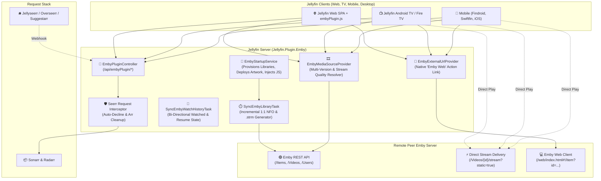

<div align="center">

# 🎬 Jellyfin Emby Federation & Bridge Plugin (`Jellyfin.Plugin.Emby`)

**A 1:1 Emby Server Federation, Metadata Mirroring, and Stream Bridge Built Natively for Jellyfin 10.10+ & 12.x**

[](https://dotnet.microsoft.com/)
[](https://jellyfin.org/)
[](https://emby.media/)
[](https://github.com/Fallenbagel/jellyseerr)
[](LICENSE)

*Seamlessly integrate any remote or peer Emby media server into your local Jellyfin instance with **1:1 metadata mirroring**, **zero-buffer `.strm` direct play**, **dynamic multi-quality stream resolution**, **remote Emby server rate-limiting & protection**, **native external link buttons**, and an **intelligent Seerr / Suggestarr Request Guard** that eliminates duplicate downloads.*

</div>

---

## 📖 Table of Contents

1. [Overview & Core Philosophy](#-overview--core-philosophy)
2. [System Architecture](#-system-architecture)
3. [Key Features Breakdown](#-key-features-breakdown)
   - [1. 1:1 Complete Metadata Mirroring (Actors, Directors, Writers, Studios, Chapters)](#1-11-complete-metadata-mirroring)
   - [2. Dynamic Multi-Version Quality, Audio Track & Subtitle Selection](#2-dynamic-multi-version-quality-audio-track--subtitle-selection)
   - [3. Native "Emby Web" Direct Link Button (`IExternalUrlProvider`)](#3-native-emby-web-direct-link-button)
   - [4. Remote Emby Server Protection & Rate-Limiting](#4-remote-emby-server-protection--rate-limiting)
   - [5. Zero-Buffer Direct Play & Stream Proxy Engine](#5-zero-buffer-direct-play--stream-proxy-engine)
   - [6. Intelligent Seerr / Jellyseerr / Overseerr Request Guard](#6-intelligent-seerr--jellyseerr--overseerr-request-guard)
   - [7. Bi-Directional Watch Progress & Favorite Synchronization](#7-bi-directional-watch-progress--favorite-synchronization)
   - [8. Item Blacklist & `.embyignore` Protection](#8-item-blacklist--embyignore-protection)
   - [9. Dedicated or Merged Libraries with Auto-Provisioned Artwork](#9-dedicated-or-merged-libraries-with-auto-provisioned-artwork)
   - [10. Multi-User Account Mapping & Anonymous Fallback](#10-multi-user-account-mapping--anonymous-fallback)
4. [Complete Configuration Reference (`PluginConfiguration`)](#-complete-configuration-reference-pluginconfiguration)
5. [Native Jellyfin Providers, Channels & Services](#-native-jellyfin-providers-channels--services)
6. [Scheduled Tasks Reference](#-scheduled-tasks-reference)
7. [REST API Endpoints Reference (`/api/embyPlugin/*`)](#-rest-api-endpoints-reference-apiembyplugin)
8. [On-Disk Directory & Metadata Structure](#-on-disk-directory--metadata-structure)
9. [Installation & Deployment](#-installation--deployment)
10. [Troubleshooting & Diagnostics](#-troubleshooting--diagnostics)

---

## 🌟 Overview & Core Philosophy

Because Jellyfin originally forked from Emby 3.5.2, both media servers share an identical core data model and NFO metadata standard. However, existing federation solutions either duplicate heavy video files to local disk, fail to pass through audio and subtitle options, or trigger aggressive library scans that overload remote peer servers.

**`Jellyfin.Plugin.Emby`** bridges this gap by acting as a native federation layer:

- **Zero Local Disk Space:** Movies and TV episodes are saved as lightweight pointer `.strm` files and `.nfo` metadata sidecars (`<10 KB` per item). Media bytes are streamed on-demand.
- **1:1 Metadata Fidelity:** Automatically mirrors actors with roles and headshots, directors, writers, producers, studios, genres, tags, taglines, ratings, premiered dates, and chapter markers directly from Emby into Jellyfin.
- **Remote Server Protection:** Employs incremental synchronization via `MinDateLastSaved`, configurable sync intervals (`SyncIntervalHours`), and millisecond request throttling (`ApiRequestDelayMs`) to keep bandwidth and CPU usage on the remote Emby server near zero.
- **Multi-Version & Quality Selection:** Inspects remote container streams and dynamically populates Jellyfin's video quality picker (4K, 1080p, 720p), language-specific audio streams (e.g., German DTS 5.1 vs. English Stereo), and text subtitles (SRT/VTT).
- **Proactive Request Protection:** When users request media in Jellyseerr or Suggestarr, the plugin intercepts the webhook, checks Emby availability, cancels unnecessary downloads, and links directly to the existing stream.

---

## 🏗 System Architecture



---

## 🚀 Key Features Breakdown

### 1. 1:1 Complete Metadata Mirroring

Because Jellyfin natively inherits Emby's XML/NFO parsing structure, `SyncEmbyLibraryTask` mirrors every available metadata field 1:1:

| Field | NFO XML Tag | Description |
| :--- | :--- | :--- |
| **Cast & Crew** | `<actor><name>, <role>, <thumb>` | All actors, characters, and high-res headshot URLs. |
| **Directors** | `<director>` | Full directing credits. |
| **Writers & Producers** | `<writer>`, `<producer>` | Screenplay, writing, and production credits. |
| **Studios & Networks** | `<studio>` | Production companies and broadcast networks. |
| **Tags & Taglines** | `<tag>`, `<tagline>` | Mood tags, user tags, and official taglines. |
| **Ratings & Certifications** | `<rating>`, `<criticrating>`, `<mpaa>` | Community score, critic score, and age rating (FSK, MPAA). |
| **Chapters** | `<chapters><chapter>` | Chapter timestamps and chapter titles. |
| **Stream Details** | `<fileinfo><streamdetails>` | Codec (`h264`, `hevc`), width, height, aspect ratio, audio channels, and languages. |
| **External Links** | `<website>`, `<homepage>` | Clickable links to the remote Emby Web item. |

---

### 2. Dynamic Multi-Version Quality, Audio Track & Subtitle Selection

`EmbyMediaSourceProvider` dynamically queries the remote Emby server at playback time:
- **Multi-Version Resolution:** Supports items with multiple files (e.g. 4K UHD Remux, 1080p, 720p).
- **Audio Stream Picker:** Exposes all audio container streams with accurate channel counts (Stereo 2.0, 5.1 Surround, 7.1 TrueHD), codec tags, and language metadata.
- **External Subtitles:** Delivers text subtitles (SRT, VTT) directly to Jellyfin clients via zero-latency HTTP streaming URLs.

---

### 3. Native "Emby Web" Direct Link Button

`EmbyExternalUrlProvider` implements Jellyfin's native `IExternalUrlProvider` interface. For any federated item:
- A prominent **Emby Web** button appears in the **Links** section of the Jellyfin Web and Mobile detail views.
- Clicking the link opens the item directly in the remote Emby web client (`https://emby.example.com/web/index.html#!/item?id=...`).

---

### 4. Remote Emby Server Protection & Rate-Limiting

Designed specifically for sensitive peer servers, the plugin includes multi-tiered rate limiting:
- **`EnableIncrementalSync`**: Queries Emby using `MinDateLastSaved`. Only items created or modified since the last synchronization are fetched.
- **`SyncIntervalHours`**: Configurable sync interval (e.g. every 24 hours) to prevent frequent polling.
- **`ApiRequestDelayMs`**: Enforces a configurable millisecond sleep (default: `50ms`) between API requests to prevent triggering rate-limiters or web application firewalls.
- **Timestamp Tracking**: Records `LastSyncUtc` and `LastSyncItemCount` directly in the plugin configuration.

---

### 5. Zero-Buffer Direct Play & Stream Proxy Engine

- **Direct URLs (`UseDirectEmbyStreamUrls = true`):** Clients connect directly to Emby (`/emby/Videos/{id}/stream?static=true&api_key=...`). Traffic completely bypasses the Jellyfin server host, saving host bandwidth and CPU.
- **HTTP Range Proxy (`/api/embyPlugin/stream/{id}`):** When direct access is disabled or clients are outside the network, Jellyfin proxies the stream with full `206 Partial Content` Range headers for instant seeking.

---

### 6. Intelligent Seerr / Jellyseerr / Overseerr Request Guard

Prevents duplicate downloads and saves local disk storage:
1. Jellyseerr forwards media request webhooks to `/api/embyPlugin/webhook/seerr`.
2. The plugin checks the remote Emby server via TMDb or TVDb ID.
3. If already available, the request is automatically **declined/canceled in Seerr** with a direct link to the Emby stream.
4. If configured, pending tasks in **Sonarr** or **Radarr** are cleaned up automatically without deleting existing files.

---

### 7. Bi-Directional Watch Progress & Favorite Synchronization

- **Jellyfin $\rightarrow$ Emby:** Listening to `ISessionManager.PlaybackStopped` and `IUserDataManager.UserDataSaved` marks items as watched, updates playback checkpoints, and synchronizes favorites (`♥️`) on Emby in real-time.
- **Emby $\rightarrow$ Jellyfin:** The `SyncEmbyWatchHistoryTask` background job periodically syncs watched items and playback ticks back into Jellyfin user profiles.

---

### 8. Item Blacklist & `.embyignore` Protection

Permanently prevent unrequested or unwanted items from being synchronized:
- **Host `.embyignore` File:** Place a `.embyignore` file inside your storage path (e.g. `/data/emby/.embyignore`). Supports TMDb IDs, Emby IDs, or titles.
- **Dashboard Blacklist:** Enter comma-separated TMDb IDs in the plugin settings (`ExcludedTmdbIds`).

---

### 9. Dedicated or Merged Libraries with Auto-Provisioned Artwork

- **Dedicated Mode:** Automatically creates clean **Filme (Emby)** and **Serien (Emby)** virtual folders optimized for fast scanning (disabling redundant chapter/trickplay extractors).
- **Merged Mode:** Automatically mounts `/data/emby/movies` and `/data/emby/tv` into existing `Filme` and `Serien` folders.
- **Artwork Auto-Deployment:** Automatically deploys bundled, high-resolution library posters, backdrops, logos, banners, and thumbnails from `Artwork/` to the media roots and Jellyfin display cache.

---

### 10. Multi-User Account Mapping & Anonymous Fallback

- **Multi-User Isolation:** Map individual Jellyfin users to their own personal Emby credentials (`EmbyUserAccountEntry`) for personalized playhead progress.
- **Public Fallback:** Unlinked Jellyfin users can either fall back to the shared/primary Emby account (`EnablePublicFallbackForUnlinkedUsers = true`) or be restricted completely.

---

## ⚙️ Complete Configuration Reference (`PluginConfiguration`)

| Property | Type | Default | Description |
| :--- | :--- | :--- | :--- |
| **`EmbyServerUrl`** | `string` | `""` | Base URL of the remote Emby server (e.g. `https://stream.example.com`). |
| **`EmbyUsername`** | `string` | `""` | Primary Emby username used for administrative synchronization. |
| **`EmbyPassword`** | `string` | `""` | Primary Emby user password (exchanged for API token). |
| **`EmbyApiKey`** | `string` | `""` | Emby User Access Token (auto-generated or configured). |
| **`EmbyUserId`** | `string` | `""` | Emby User GUID for watch state queries. |
| **`EmbyServerId`** | `string` | `""` | Unique Server Identifier of the peer Emby server. |
| **`EnableLibraryFederation`** | `bool` | `true` | Master switch for `.strm` and `.nfo` filesystem synchronization. |
| **`EnableMoviesFederation`** | `bool` | `true` | Synchronize movies catalog into `/data/emby/movies`. |
| **`EnableSeriesFederation`** | `bool` | `true` | Synchronize TV series & episodes into `/data/emby/tv`. |
| **`AttachToExistingLibraries`** | `bool` | `false` | Merge Emby paths into existing default `Filme` / `Serien` libraries. |
| **`CreateDedicatedEmbyLibraries`**| `bool` | `true` | Create dedicated `Filme (Emby)` and `Serien (Emby)` libraries. |
| **`TargetMoviesLibraryName`** | `string` | `"Filme (Emby)"` | Target Jellyfin library name for movies. |
| **`TargetSeriesLibraryName`** | `string` | `"Serien (Emby)"` | Target Jellyfin library name for TV shows. |
| **`StrmLibraryPath`** | `string` | `"/data/emby"` | On-disk root directory for `.strm` and `.nfo` files. |
| **`UseDirectEmbyStreamUrls`** | `bool` | `true` | Stream directly from Emby API instead of proxying through Jellyfin. |
| **`EnablePlayheadSync`** | `bool` | `false` | Enable bi-directional playback checkpoint and played state sync. |
| **`EnableFavoriteSync`** | `bool` | `false` | Enable bi-directional favorite (`♥️`) synchronization. |
| **`FetchArtworkFromEmby`** | `bool` | `true` | Extract primary posters and backdrops directly from Emby. |
| **`EnableSeerrRequestGuard`** | `bool` | `true` | Intercept Seerr requests for media already available on Emby. |
| **`SeerrUrl`** | `string` | `"http://jellyseerr:5055"` | URL to Jellyseerr / Overseerr instance for request cancellation. |
| **`SeerrApiKey`** | `string` | `""` | Seerr API Key with administrative permissions. |
| **`SonarrUrl` / `RadarrUrl`** | `string` | `""` | URLs to Sonarr and Radarr instances. |
| **`SonarrApiKey` / `RadarrApiKey`**| `string` | `""` | API keys to clean up pending Arr monitoring entries. |
| **`ExcludedTmdbIds`** | `string` | `""` | Comma-separated TMDb IDs to permanently blacklist from syncing. |
| **`SyncIntervalHours`** | `int` | `24` | Default scheduled interval in hours between full library synchronizations. |
| **`EnableIncrementalSync`** | `bool` | `true` | Fetch only items modified since `LastSyncUtc` (`MinDateLastSaved`). |
| **`ApiRequestDelayMs`** | `int` | `50` | Milliseconds to pause between remote Emby API calls. |
| **`LastSyncUtc`** | `DateTime?` | `null` | Timestamp of the last successful synchronization. |
| **`LastSyncItemCount`** | `int` | `0` | Count of media items checked during the last sync. |
| **`EnablePublicFallbackForUnlinkedUsers`**| `bool` | `true` | Allow unlinked Jellyfin users to stream via the shared Emby account. |
| **`PrimaryJellyfinUser`** | `string` | `""` | Jellyfin username bound to the primary Emby credentials. |

---

## 🧩 Native Jellyfin Providers, Channels & Services

| Service / Provider | Interface | Purpose |
| :--- | :--- | :--- |
| **`EmbyStartupService`** | `IHostedService` | Bootstraps configuration from environment variables or seed files, injects UI script, provisions libraries, and listens to playback events. |
| **`EmbyMediaSourceProvider`** | `IMediaSourceProvider` | Dynamically resolves container versions, video bitrates/resolutions, audio tracks, and external subtitles for playback. |
| **`EmbyExternalUrlProvider`** | `IExternalUrlProvider` | Adds the official "Emby Web" link button in item details. |
| **`EmbyImageProvider`** | `IRemoteImageProvider` | Serves remote posters, backdrops, and banners from Emby without saving image files to disk. |
| **`EmbyMovieExternalId`** | `IExternalId` | Registers the `EmbyItemId` provider identifier for movies. |
| **`EmbySeriesExternalId`** | `IExternalId` | Registers the `EmbyItemId` provider identifier for series. |
| **`EmbyEpisodeExternalId`** | `IExternalId` | Registers the `EmbyItemId` provider identifier for episodes. |

---

## ⏱️ Scheduled Tasks Reference

| Task Name | Task Key | Default Trigger | Description |
| :--- | :--- | :--- | :--- |
| **Federate Emby Media Library** | `SyncEmbyLibraryTask` | Every 24 hours (configurable via `SyncIntervalHours`) | Scans remote Emby catalog incrementally, writes `.strm` pointers, generates 1:1 `.nfo` files, and triggers a Jellyfin library refresh. |
| **Sync Emby Watch Progress & Favorites** | `SyncEmbyWatchHistoryTask` | Every 1 hour | Pulls watched state, resume ticks, and favorites from Emby into linked Jellyfin user profiles. |

---

## 🔌 REST API Endpoints Reference (`/api/embyPlugin/*`)

| Endpoint | Method | Auth | Description |
| :--- | :---: | :---: | :--- |
| **`/api/embyPlugin/Script`** | `GET` | Anonymous | Serves the injected `embyPlugin.js` frontend client modal. |
| **`/api/embyPlugin/status`** | `GET` | Anonymous | Returns active connection state, sync counts, and library paths. |
| **`/api/embyPlugin/auth/test`** | `POST` | Anonymous | Tests and authenticates credentials with the remote Emby server. |
| **`/api/embyPlugin/sync`** | `POST` | Anonymous | Manually triggers an immediate incremental library federation sync. |
| **`/api/embyPlugin/search`** | `GET` | Anonymous | Searches the remote Emby catalog by keyword (supports `type=movie` or `series`). |
| **`/api/embyPlugin/check-availability`** | `GET` | Anonymous | Checks if a TMDb, TVDb, or IMDb ID exists on the remote Emby server. |
| **`/api/embyPlugin/webhook/seerr`** | `POST` | Anonymous | Webhook receiver for Jellyseerr / Overseerr media requests. |
| **`/api/embyPlugin/stream/{id}`** | `GET` | Anonymous | HTTP Range streaming proxy with direct stream redirection fallback. |

---

## 📂 On-Disk Directory & Metadata Structure

```text
/data/emby/
├── .embyignore                                      # Item exclusion blacklist
├── movies/
│   ├── poster.png                                   # Auto-provisioned library poster
│   ├── backdrop.png                                 # Auto-provisioned library backdrop
│   └── Inception (2010) [tmdbid-27205]/
│       ├── Inception (2010) [tmdbid-27205].strm     # Stream pointer (direct play URL)
│       └── Inception (2010) [tmdbid-27205].nfo      # 1:1 NFO metadata sidecar
└── tv/
    ├── poster.png
    ├── backdrop.png
    └── Breaking Bad (2008) [tvdbid-81189]/
        ├── tvshow.nfo                               # Series-level 1:1 NFO
        └── Season 01/
            ├── S01E01 - Pilot.strm
            └── S01E01 - Pilot.nfo                   # Episode-level 1:1 NFO
```

---

## 📦 Installation & Deployment

### Option A: Via Jellyfin Plugin Repository (Recommended)
1. In the Jellyfin Dashboard, navigate to **Plugins** $\rightarrow$ **Repositories**.
2. Click **+** and add:
   * **Repository Name**: `Emby Federation Plugin`
   * **Repository URL**: `https://raw.githubusercontent.com/FaserF/emby-jellyfin/main/manifest.json`
3. Go to the **Catalog** tab, select **Emby Federation & Bridge**, and click **Install**.
4. Restart your Jellyfin server.

### Option B: Zero-Secret Docker Environment Variables
Configure the plugin completely headless without entering credentials into the Web UI:
```yaml
services:
  jellyfin:
    image: jellyfin/jellyfin:latest
    environment:
      - EMBY_PEER_URL=https://emby.example.com
      - EMBY_PEER_USERNAME=myuser
      - EMBY_PEER_PASSWORD=mypassword
      - JELLYSEERR_API_KEY=your_seerr_api_key
    volumes:
      - /path/to/media/emby:/data/emby
```

### Option C: Manual Compilation (.NET 10 SDK)
```bash
# Build the plugin DLL
dotnet build -c Release Jellyfin.Plugin.Emby/Jellyfin.Plugin.Emby.csproj

# Copy binaries into Jellyfin plugins directory
cp Jellyfin.Plugin.Emby/bin/Release/net10.0/Jellyfin.Plugin.Emby.dll /path/to/jellyfin/plugins/Emby/
cp Jellyfin.Plugin.Emby/bin/Release/net10.0/Jellyfin.Plugin.Emby.pdb /path/to/jellyfin/plugins/Emby/
```

---

## 🔍 Troubleshooting & Diagnostics

- **Items Not Showing in Jellyfin:** Ensure `/data/emby/movies` and `/data/emby/tv` are either mounted into existing libraries or configured as dedicated libraries. Trigger a manual library scan via Jellyfin Dashboard.
- **Remote Emby Rate-Limiting:** If your peer Emby server limits connections, increase `ApiRequestDelayMs` (e.g. `100ms` or `200ms`) and increase `SyncIntervalHours` (e.g. `24` or `48`). Ensure `EnableIncrementalSync = true`.
- **Stream Playback Issues:** If your client cannot reach the peer Emby server directly, set `UseDirectEmbyStreamUrls = false` to route playback through Jellyfin's internal HTTP stream proxy.
- **Unrequested Items:** Add unwanted TMDb IDs to `ExcludedTmdbIds` in settings or append them to `/data/emby/.embyignore`.

---

## 📄 License

This project is licensed under the [MIT License](LICENSE).
